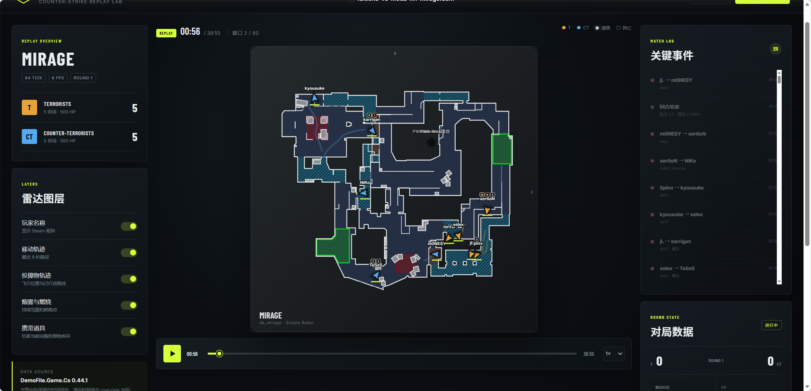

# CS Demo Map

> 2026-10-23 更新：GSI 已修复 CT 拆弹器字段省略处理，首场同场复验见[修复报告](docs/win-gsi-defusekit-fix-report-20261019.md)。跨比赛准确性仍待验证，已发布模型权重不变；回放界面更新单独发布在 `main`。

[English](README.md) | 简体中文

CS Demo Map 是一个面向 Counter-Strike 2 的比赛回放与胜率分析项目。导入 `.dem` 录像后，可以在交互式雷达地图上查看比赛进程，并结合玩家状态、装备和炸弹情况，观察当前回合的胜率变化。

项目目前以 **Mirage** 为主要支持地图，适合用于比赛复盘、战术观察和胜率模型研究。



## 主要功能

- **Demo 导入与地图回放**：读取 CS2 比赛录像，在雷达地图上展示玩家位置、朝向、血量、武器和装备。
- **交互式播放控制**：支持播放、暂停、时间跳转和倍速，便于定位并反复查看关键时刻。
- **轨迹与道具展示**：显示玩家移动路线、投掷物、烟雾和燃烧区域，支持按需切换显示图层。
- **回合胜率预测**：配置配套模型后，随回放进度展示 T 方和 CT 方赢下当前回合的估计概率。
- **内置示例模式**：无需准备真实 Demo 或模型，即可通过模拟数据体验回放界面。

回放采用俯视雷达视角，重点呈现站位与局势变化，不提供游戏内的第一人称画面。

## 胜率预测说明

模型使用录像当前时刻已知的信息进行预测，通常约每秒更新一次。预测目标是**当前回合的胜方**，不涉及整张地图或整场比赛的最终结果。

胜率用于辅助理解局势，不是确定的胜负结论。回合开局、双方人数相同或信息不足时，预测仍存在较大不确定性。

胜率卡片同时显示预测对应的录像时间。回合准备阶段、结束后或当前预测不可用时，会清空旧值，避免造成误读。

模型缺失或加载失败时，Demo 导入和回放仍可使用，界面会提示胜率预测不可用。

## 快速体验

项目目前以源码形式提供，需要在本地安装依赖并启动。

体验示例只需 **Node.js 20.19+（20.x）或 22.12+**。下载或克隆项目后，在项目根目录打开终端（Windows 可使用 PowerShell），执行：

```bash
npm install
npm run dev:web
```

上述命令会安装前端依赖并启动示例界面，首次安装需要联网。

启动后访问 [http://localhost:5173](http://localhost:5173)，实际地址以终端输出为准。使用期间请保持服务运行。

示例模式使用内置模拟数据。导入真实 Demo 需要启动完整服务，步骤如下。

## 本地运行与 Demo 导入

完整回放服务还需要 **.NET SDK 10.0 或更新版本**。启用胜率预测时，需要额外准备 **Python 3、pip** 和配套模型包。

在项目根目录安装依赖：

```bash
npm install
dotnet restore apps/api/CsDemoMap.Api.csproj
```

需要胜率预测时，安装 Python 依赖：

```bash
python -m pip install -r requirements-inference.txt
```

**仓库不包含产品默认模型、训练数据集和真实 Demo；`codex/endgame-model` 分支包含独立残局模型包。** 胜率预测需要另行配置与当前版本匹配的模型；模型目录及配置方式见下方“配置与开发”。

如果示例服务仍在运行，先按 `Ctrl+C` 停止，再启动完整服务：

```bash
npm run dev
```

启动后访问 [http://localhost:5173](http://localhost:5173)：

1. 在页面右上角选择 CS2 `.dem` 文件。
2. 等待导入完成，页面会显示读取和处理进度；大文件耗时可能较长。
3. 使用播放控件、时间条和倍速选项进行复盘。
4. 模型可用时，回合进行过程中会显示双方胜率；否则仅提供回放。

使用结束后，可在终端按 `Ctrl+C` 停止服务。

## 独立残局预测与 GSI 录制（实验）

[`endgame_prediction/`](endgame_prediction/README.md) 提供独立的 Mirage 残局胜率预测：双方各有存活玩家、合计不超过 7 人时，估计当前回合胜方。它不改变回放界面、API 或默认模型。

[`endgame_prediction/gsi/`](endgame_prediction/gsi/README.md) 可接收 CS2 完整观战模式的 GSI 数据，并在本地保存原始快照、接收时间和逐条预测。录制器默认使用 `127.0.0.1:3002`，本分支包含匹配的残局模型包，原始数据和录制结果不随 GitHub 分发。安装 Python 依赖后，按[整场录制指南](endgame_prediction/gsi/README.md#录制一场完整比赛)安装配置、启动和停止。

GSI 工程测试已通过，跨比赛字段对齐与预测效果仍待验证；普通玩家视角缺少完整双方数据。

## 开发状态

截至 **2026-10-18**：

- **已实现**：Mirage 回放、播放控制、玩家与道具展示，以及配套模型的回合胜率预测。
- **持续改进**：当前胜率模型已完成额外 13 场比赛的评估，开局和双方人数相同的场景仍是主要改进方向。
- **实验阶段**：独立残局预测、GSI 接收与录制已实现；站位特征的模型对照已完成开发评估，正式采用仍需新比赛验证。自动局势解说仍在研发，上述实验均未接入用户界面。

## 当前限制

- 主界面分析已录制的 Demo；GSI 数据通过独立实验脚本接收，尚未接入主界面。
- 当前预测和地图配置主要针对 Mirage，其他地图的效果尚未验证。
- 大型 Demo 的处理时间和内存占用可能较高。
- 导入记录暂不持久保存，重启服务后需要重新导入。

<details>
<summary>配置与开发：模型设置、验证命令和相关文档</summary>

### 模型配置

默认模型目录：

```text
models/win-baseline-v4-holdout-87-8-20260908
```

请使用与当前程序的数据版本匹配的完整模型包，避免混用不同版本的模型和配置。

如需调整 Python 命令或模型目录，可在 Windows PowerShell 中配置后启动：

```powershell
$env:WinInference__PythonExecutable = "python"
$env:WinInference__ModelDirectory = "models/win-baseline-v4-holdout-87-8-20260908"
npm run dev
```

启动后，[模型状态页面](http://localhost:5088/api/win-model/status)会返回状态信息；`ready` 表示模型可用，`unavailable` 或 `disabled` 表示当前无法提供预测。

### 开发验证

修改代码后，可按需要执行类型检查、测试与构建，或查看工具命令：

```bash
npm run typecheck
npm test
npm run build
npm run test:groups -- --help
npm run cli -- --help
```

运行测试前需安装对应依赖，部分检查还需要本地模型或 Demo。模型训练和批量数据处理应使用新的输出目录，避免覆盖已有结果。

更多资料：

- [项目架构](docs/architecture.md)
- [数据处理命令](apps/cli/DeveloperCommandHelp.cs)
- [胜率评估工具](tools/win_experiment.py)
- [站位数据检查工具](tools/audit_win_spatial.py)

</details>

## 致谢

录像读取使用 [demofile-net](https://github.com/saul/demofile-net)（MIT 许可证）。Simple Radar 地图素材来自 [cs-hud](https://github.com/drweissbrot/cs-hud)。素材来源与使用说明见[第三方声明](THIRD_PARTY_NOTICES.md)。
